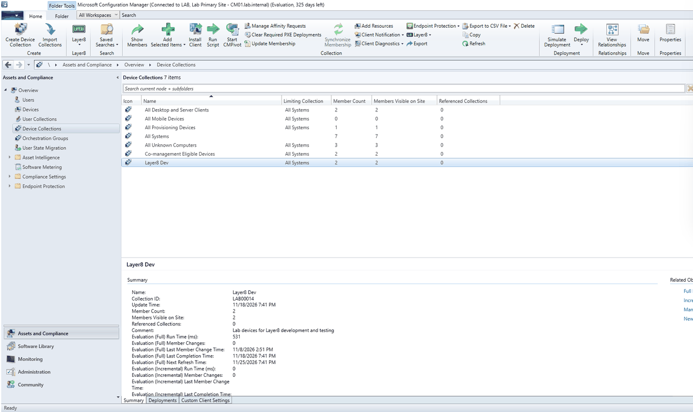
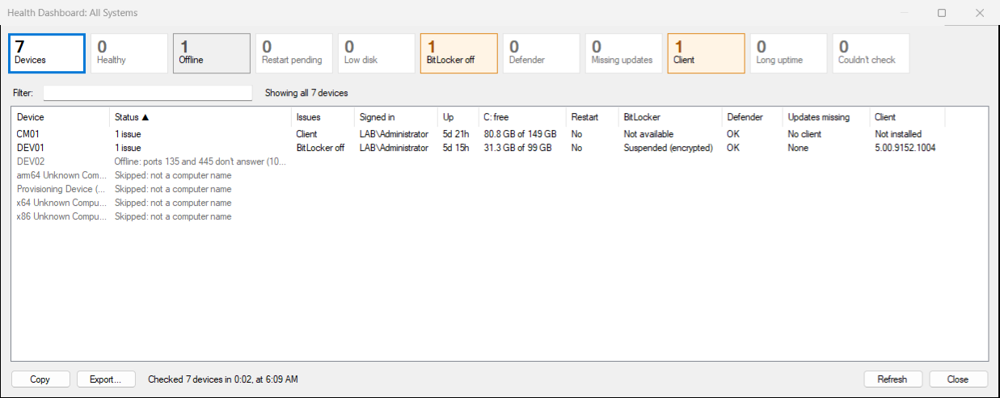
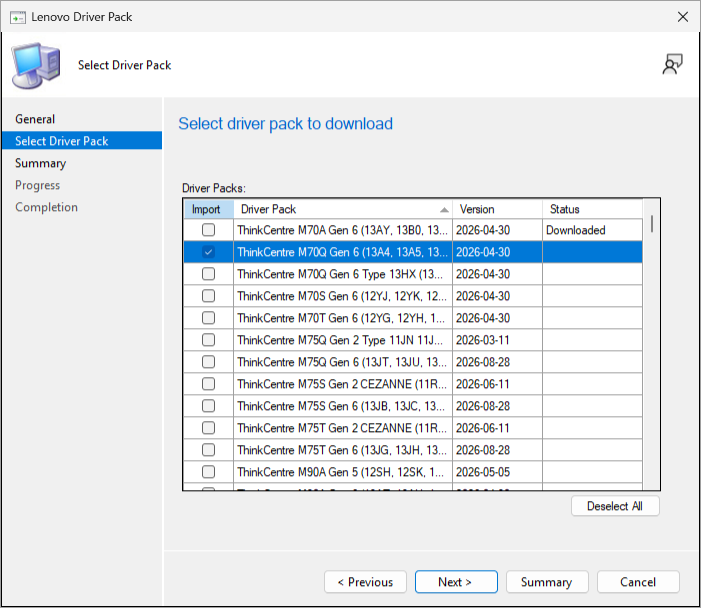
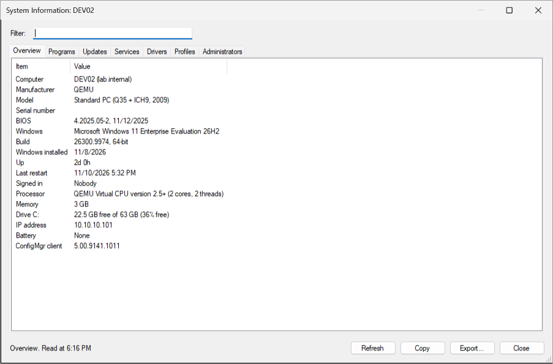
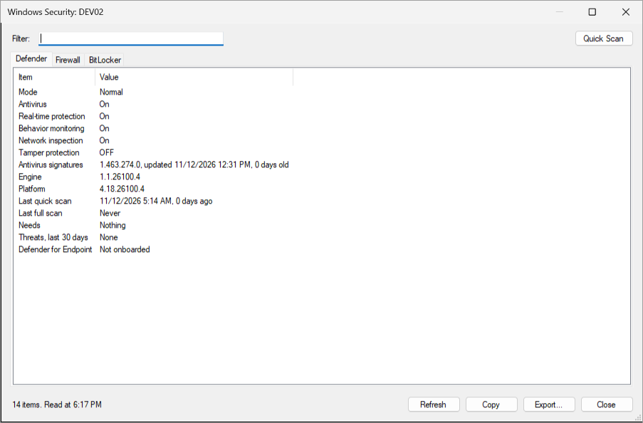

# Layer8

Open-source right-click actions for the ConfigMgr (MECM) console. Because it's always layer 8.

Layer8 starts from [ConfigMgr Quick Tools](https://github.com/Flowman/ConfigMgr-Quick-Tools) by Peter Szalatnay and builds on it. It's an independent project and isn't affiliated with Microsoft or Recast Software.



## What's in it

Organized by where you right-click in the console. [The tour](docs/TOUR.md) has a screenshot of each. Right-clicking a device or a device collection shows one **Layer8** menu: Health Dashboard first, then **Status** (read-only checks), **Client Cycles**, **Fix** (changes something on the device) and **Power and Users**, plus **Security** and **Remote Tools** on a device, each alphabetical inside.

**Health Dashboard** (right-click a device collection, or select devices): one live pass over every device, with tiles counting what needs attention: offline, restart pending, low disk (under 10 GB free on C:), BitLocker off, Defender off or out of date, blue screens in the last two weeks (with the stop code), missing updates, clients whose last update scan is two weeks old or that have never scanned, workstations on a Windows build older than 26100 (24H2), client problems, clients the site hasn't heard from in a week, and up 14 days or more. Each run on a collection is kept, so the next one shows what changed: a Changed tile and a Since last run column ("New: Not scanning", "Gone: Blue screen"), and each tile's count up or down. Click a tile to see just those devices, then fix them from the same window. Not scanning, Client, Restart pending and Not reporting get a Fix button that runs the matching client action on the devices shown (an update scan, a health check or client repair, a restart, a policy request), and BitLocker off and Defender open Windows Security for a device. A fix always asks first, names who it leaves out (offline, no client, and for a restart servers and the console's own computer), and a restart is capped at 50 devices and has you type the count. Or select devices and right-click for the console's client actions (policy and inventory cycles, update scans and installs, restarts, client repair, Defender scans). A device that's offline shows when ConfigMgr last heard from it, and what ConfigMgr last had on it in grey: the last user, Windows build, pending restart and client from its check-ins, and C: free from its last hardware inventory, with that inventory's age. The grid sorts, filters as you type, copies and exports; double-click a device for System Information. The check itself only reads.



**A device, or a device collection** (a collection runs on every member):
- **Status, Client Cycles and Fix:** the eleven standard client cycles, plus Quick Status (who's signed in, uptime, free space on C:, IP address, client version, each in a column you can sort), Find Software (by name, or older than a version: `Chrome < 131`), Check Pending Restart, List Missing Updates (deployed ones, and ones a device needs that nothing deploys) and Install Missing Updates, Full Machine Policy Refresh, Group Policy Update, Client Health Check, Client Info, Reset Policy, Clear Client Cache, Repair Client, Turn Off Provisioning Mode, Restart SMS Agent Host Service, Send Message (a pop-up for whoever is signed in), Restart Computer and Cancel Restart, Defender Status and Quick Scan, BitLocker Status
- **On a collection, also:** Online Status, Collect Client Logs, and Retry All Failed Deployments (every app, update and baseline deployment to the collection, on the devices in error)
- Every run shows one answer per device: done, offline, blocked, or why it failed. It works through 32 devices at a time (change it in Layer8 Settings), and Run Again on Failed, Copy Results (for Excel) and Export are on every result window

**A device:**
- **Remote Tools:** Online Status (ping, or port 445 when ping is blocked), Ping, Remote Desktop, Remote Assistance, PowerShell Session, Browse C$, Client Logs, Browse ccmcache, Client Log in CMTrace, Collect Client Logs (zipped to your desktop), Computer Management, Event Viewer, Services
- **Install Application:** the apps deployed to the device; install one now, like Software Center
- **LAPS Password** (Windows LAPS, encrypted or not, and legacy LAPS, with Expire Now) and **BitLocker Recovery Key** (type the Key ID from the recovery screen to find the right key), both from Active Directory
- Copy Names, Copy Device Info, Add to existing collections, Show Messages, Client Cache, Driver Grabber, and extra device properties tabs (update compliance, client health, collection membership)

**A collection:** Add Resources List and Remove Resources List (paste names), Copy Member Names

**AD Cleanup Report** (a device collection's Layer8 menu): your domain's computer objects beside the site's device records, with tiles for what doesn't add up. **Not in AD**: a record whose computer object is gone. **Disabled**: the object is disabled. **Stale**: neither AD nor a client has seen it in 90 days. **AD unused**: the client reports but the computer's account hasn't been used, a broken trust relationship or a rename. **Client silent**: AD sees it but its client doesn't report. **No client**: AD sees it, the site has no client for it. Records match computer objects by SID, so a rename doesn't break the match, and by name only when the record has no SID and just one object could be it. It covers the whole domain and site, whichever collection you start from. Workstations only leaves servers and domain controllers out. The grid sorts, filters as you type, copies and exports. It only reads AD and the site and contacts no device, and its AD search loads names, dates and the enabled flag, never a LAPS password or a BitLocker key.

**Monitoring:**
- **Deployments:** Retry Failed Devices (re-runs the deployment on every device in error; for an Available app, installs it), Copy Failed Devices (with error codes), Delete
- **Distribution Status:** Redistribute Failed Content, Copy Failed Distribution Points

**Elsewhere:** Quick Deployment (deploy to several collections at once), Task Sequence Export to XML, Clean Software Update Groups, Remove Retired Content, Incremental Collections and Collection Evaluation Statistics, Driver Manager (grabber, importers, Dell, HP and Lenovo driver packs; Lenovo's ticks the models your site has and checks each download against Lenovo's signed catalog)



**System Information** (a device's Layer8 menu): one window instead of remoting in. Tabs for an overview (model, serial, Windows version and build, uptime, memory, disks, battery health), installed programs, installed updates, services, drivers, user profiles and local administrators. Every tab sorts, filters as you type, and copies or exports what's shown. Reading changes nothing on the device. The one thing that does: **Uninstall** on the Programs tab removes a Windows Installer program quietly (msiexec /x), after asking, and says how it went.



**Windows Security** (a device's Layer8 menu): Microsoft Defender (mode, real-time and tamper protection, signature age, last scans, recent threats, Defender for Endpoint onboarding), Windows Firewall (each profile as Windows applies it, Group Policy included, and the networks it's on) and BitLocker (every drive: protection, encryption, method and the kinds of key protector; never a recovery password). Suspend BitLocker on the Windows drive for 1 to 15 restarts, for a BIOS update say, and Resume it; start a Defender quick scan.



**Error Lookup** (on the Layer8 menus): paste any error code (`0x87D00324`, `-2016410844`, `1603`) and see what it means, from ConfigMgr's own error catalog and Windows'. Copy Failed Devices and Install Application show the meaning next to every code too.

**Layer8 Settings** (on the Layer8 menus): how many devices to contact at once, a quick offline check before connecting, the log level, the Health Dashboard's thresholds, and the AD Cleanup Report's number of days.

Don't want some of it? `Customize-Layer8Cab.ps1 -Exclude LAPS, BitLockerKeys, RemoteControl` takes those menu items out of the released cab entirely, no building needed ([how](docs/INSTALL.md#leaving-features-out)).

The devices you manage need nothing installed except the ConfigMgr client, just some firewall rules: see [what the devices need](docs/INSTALL.md#the-devices-you-manage).

## Building

1. Install the ConfigMgr console and Visual Studio with the .NET desktop development workload (.NET Framework 4.8).
2. Open `Layer8.sln` and build.

Console references resolve automatically (see `Directory.Build.props`). If your console is installed somewhere unusual, build with `-p:ConfigMgrConsoleBin=<path to AdminConsole\bin>`.

Every build runs Microsoft's .NET security analyzers (`Microsoft.CodeAnalysis.NetAnalyzers`, pinned in `Directory.Build.props` and downloaded from nuget.org the first time), and a security finding stops it. Nothing they add ships. `tools\Test-Layer8Regression.ps1` lists their results and checks the scripts in `tools` as well ([CONTRIBUTING.md](CONTRIBUTING.md#testing)).

To build the packages, run `tools\Build-Layer8Msi.ps1` (everything in Release, then `Build\Installer\Release\Layer8.msi`; the first run downloads the WiX Toolset from nuget.org), then `tools\Build-Layer8Extension.ps1` for `Build\Extension\Layer8-<version>.cab` (add `-CertificateThumbprint` to sign it).

## Installing

Download `Layer8.msi` or `Layer8-<version>.cab` from [Releases](https://github.com/JBoogieman/layer8/releases). There are two ways to put Layer8 in a console. They give you the same menus. [docs/INSTALL.md](docs/INSTALL.md) explains how each one works, what it needs, step by step with screenshots, and what to do when the menus don't show up.

| | Approved console extension (`Layer8-<version>.cab`) | MSI (`Layer8.msi`) |
|---|---|---|
| How | Import it into the site once and approve it; each console installs it from the Console Extensions node | Run it on each computer with the console, or deploy it with MECM |
| Sites with **Only allow console extensions that are approved for the hierarchy** on | Works | Ignored by the console |
| Signing | Signed with a certificate the site trusts, or unsigned if the hierarchy allows it | Not needed |

If that hierarchy setting is on, use the cab. Never put both on the same console: every menu would show up twice.

## Developer install

From an elevated PowerShell with the console closed, run `tools\Install-Layer8Dev.ps1`. It builds Layer8, copies it into the console's folders and records every file it placed; `tools\Uninstall-Layer8Dev.ps1` removes exactly those files. In a lab, `tools\New-Layer8LabTestData.ps1` creates a test app, an app that always fails (for Retry Failed Devices) and a fake BitLocker recovery key to test against (`-Remove` deletes them). Don't use it on a machine where the MSI is installed: both put the same files in the same places, so uninstall one before using the other. If PowerShell blocks the script, run it as `powershell -ExecutionPolicy Bypass -File tools\Install-Layer8Dev.ps1`.

The developer install puts Layer8 in the same places as the MSI, so the console ignores it too while **Only allow console extensions that are approved for the hierarchy** is ticked (Administration > Site Configuration > Sites > Hierarchy Settings > General). Uninstalling it leaves the console's own `XmlStorage\Extensions\Actions` and `Forms` folders in place: the console needs `Actions` to load approved extensions.

## Status

Early days: see [docs/STATUS.md](docs/STATUS.md) for what's been tested, what hasn't, the known rough edges and the ideas list. Layer8 has its own assembly names, namespaces and console IDs, so its menus and dialogs no longer clash with ConfigMgr Quick Tools. Layer8 ships only its own DLLs, so the two never share a file in the console's bin folder. The one overlap left: both replace the device properties form, so with both installed, whichever was installed last supplies those tabs. Automatic update checks have been removed.

Found a security problem? Please report it privately: see [SECURITY.md](SECURITY.md).

## Logs

Layer8 writes a CMTrace-format log to `%LOCALAPPDATA%\Layer8\Logs\Layer8.log`. Each console session starts with a line showing the Layer8, console and .NET versions. To get more detail, set the log level to `Debug` in Layer8 Settings, or from a prompt (it's picked up within a few seconds, no console restart):

```
reg add HKCU\SOFTWARE\Layer8 /v LogLevel /d Debug /f
```

Use `Debug`, `Info` (the default), `Warn` or `Error`.

The Health Dashboard's thresholds, low disk (10 GB), long uptime (14 days), not reporting (7 days), blue screens (14 days), not scanning (14 days) and the Windows build (26100, or a build and update such as 26100.4652), are on the settings' Health Dashboard page, and in the same key as `LowDiskGB`, `LongUptimeDays`, `NotReportingDays`, `BlueScreenDays`, `NotScanningDays` and `WindowsBuild`. The AD Cleanup Report's days (90, ConfigMgr's own default for AD System Discovery's logon filter and for Delete Aged Discovery Data) are on its own page, and in the same key as `ADNotSeenDays`.

The log rolls over to `Layer8.lo_` at 2 MB, the same way ConfigMgr's own logs do.

## A spare-time project

Layer8 is built and tested by one person in spare time. It's free and provided as is, without warranty (see [LICENSE](LICENSE)), and there's no promised support or timeline. Issues and pull requests are welcome and get read: see [CONTRIBUTING.md](CONTRIBUTING.md) and the [roadmap](docs/ROADMAP.md). Layer8 acts with your ConfigMgr and Active Directory rights, so try each release in a lab or on a small collection before rolling it out.

## Credits and license

Based on ConfigMgr Quick Tools by Peter Szalatnay. Released under the MIT license; see [LICENSE](LICENSE).

AI was used to help bring this vision to life.
