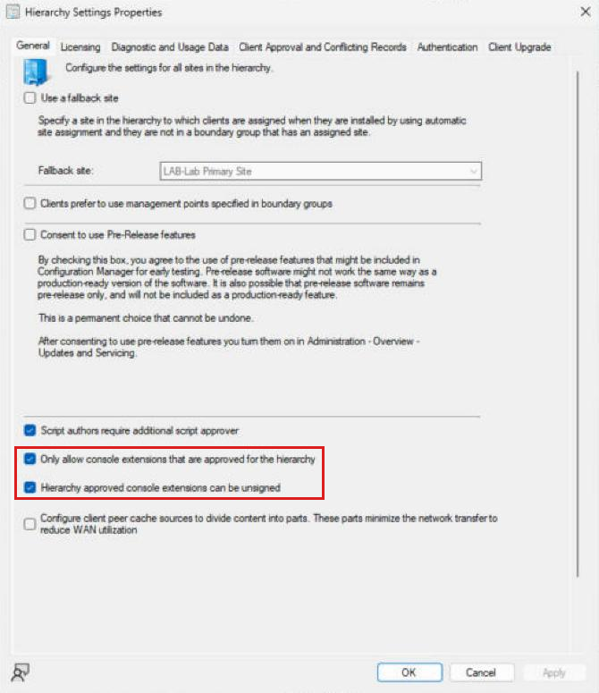
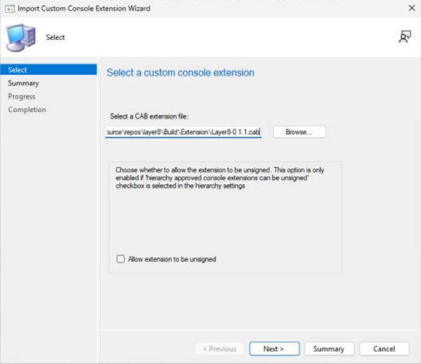
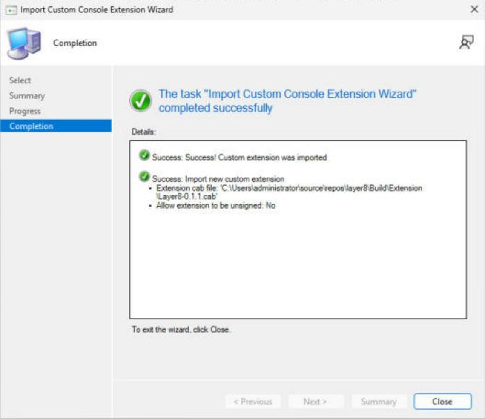
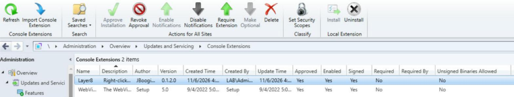
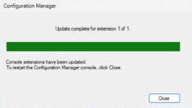
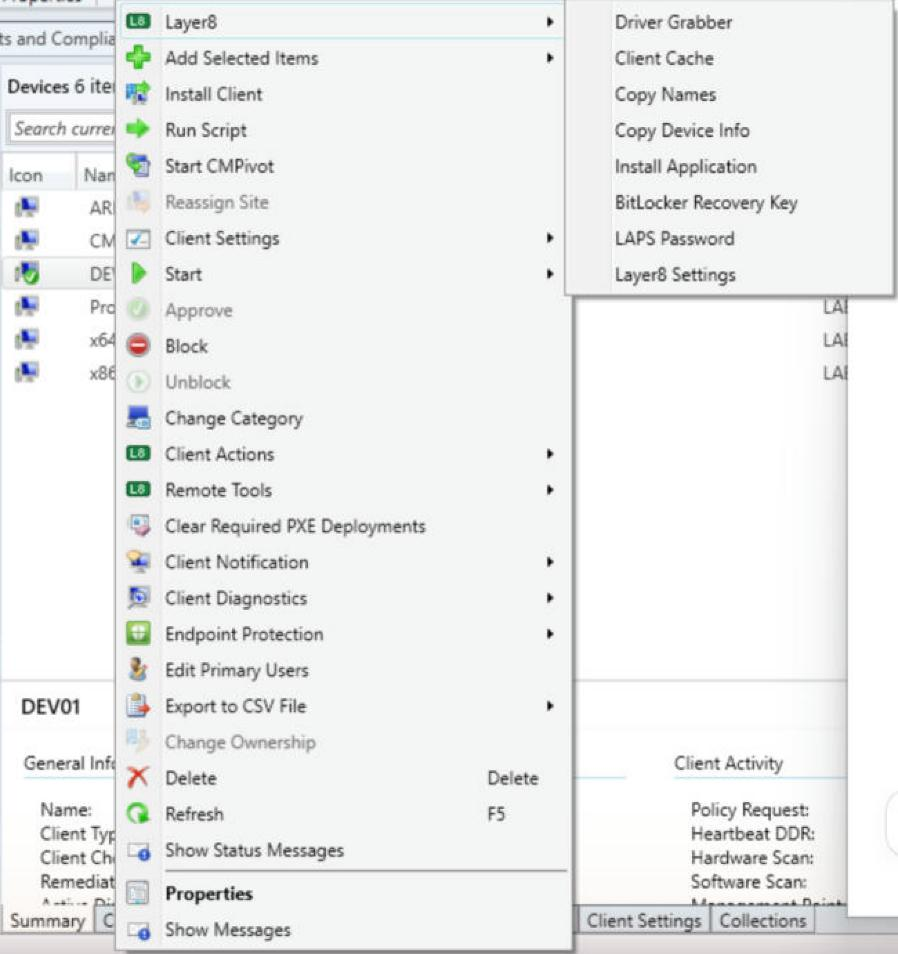

# Installing Layer8

Layer8 can go into a ConfigMgr console two ways. Both put the same menus and windows in the console; they differ in how the files get there, who has to do what, and which sites allow them.

| | **Approved console extension** (`Layer8-<version>.cab`) | **MSI** (`Layer8.msi`) |
|---|---|---|
| What it is | A package you import into the site once. ConfigMgr then installs it on each console. | An installer you run on each computer that has the console, like any other app. |
| Who does what | A ConfigMgr admin imports and approves it once. Each console user clicks Install, or you make it required and it installs itself. | Whoever deploys software: `msiexec`, or an MECM application deployed to the admins' computers. |
| Works when **Only allow console extensions that are approved for the hierarchy** is on | **Yes.** This is the only way that does. | **No.** The console ignores it. |
| Where the files go | `AdminConsole\Extensions\<Layer8's ID>\<version>\` (Layer8's own folder) | Straight into the console's own folders: `AdminConsole\bin` and `AdminConsole\XmlStorage\Extensions` |
| Updating | Import the newer cab, approve it, consoles install it | Deploy the newer MSI; it replaces the old one |
| Removing | Uninstall on one console, or revoke approval to remove it from every console | `msiexec /x`, or uninstall the MECM application |
| Signing | Signed (needs a code-signing certificate the site trusts) or unsigned (needs a hierarchy setting) | Not needed |
| Shows in Add/Remove Programs | No | Yes |

**Which one?**

- If your site has **Only allow console extensions that are approved for the hierarchy** turned on, use the cab. The MSI won't load. Microsoft turns this setting on by default when a site is installed from the 2103 baseline; sites upgraded from older versions start with it off.
- If the setting is off, either works. The cab is still the better choice for a team: one approval, no software deployment, and every console gets the same version. The MSI is there for sites that would rather deploy it like any other app, and for development.
- **Never put both on the same console.** On a site that allows both, every Layer8 menu would show up twice.

To check the setting: **Administration > Site Configuration > Sites > Hierarchy Settings** (on the ribbon) > **General** tab.



## How the console finds extensions

This is the part that explains everything else, including most problems.

When the console starts, it builds every right-click menu from XML files. For each place in the console (a *node*, such as Devices or Device Collections, each identified by a GUID), it reads two places:

```
AdminConsole\
├── bin\                                  the console's own DLLs
│   └── Layer8*.dll                       ← MSI puts Layer8's DLLs here
├── XmlStorage\Extensions\                old-style ("legacy") extensions
│   ├── Actions\                          ← ships empty with the console
│   │   └── <node GUID>\Layer8*.xml       ← MSI puts the menus here
│   └── Forms\Layer8*.xml                 ← MSI puts the windows here
└── Extensions\                           approved extensions, one folder each
    └── 3b900076-0ea8-46a7-b3b3-57bc7336c50f\    Layer8's extension ID
        └── <version>\
            ├── Actions\<node GUID>\*.xml ← cab's menus
            ├── Forms\*.xml               ← cab's windows
            └── bin\Layer8*.dll           ← cab's DLLs
```

- With **Only allow console extensions that are approved for the hierarchy** off, it reads both: everything in `XmlStorage\Extensions`, plus every approved extension installed on that console.
- With it on, it skips everything in `XmlStorage\Extensions` and reads approved extensions only.

Two details we found by testing, which Microsoft doesn't document:

- **The console only loads approved extensions while `XmlStorage\Extensions\Actions` exists.** The console installs it, empty. If it's missing, approved extensions silently don't load: in the lab, Layer8 and two one-item test extensions all disappeared, and creating the empty folder brought them all back. Uninstalling an MSI-based extension can delete it on the way out; the first Layer8.msi (0.1.0) did. See [Troubleshooting](#approved-layer8-installed-but-no-menus).
- **The console looks for DLLs in different places depending on the file.** Menus look in the extension's own `bin`, dialog pages look in `AdminConsole\bin`. The cab build script adjusts the paths in the cab's copies of the XML so both work. Nothing to do by hand; it only matters if you build your own cab another way.

---

## Way 1: Approved console extension (the cab)

### What you need

- **ConfigMgr current branch 2111 or later.** The Console Extensions node arrived in 2103, and the Import Console Extension wizard in 2111. Tested on 2509 (console 5.2509.1038.1000).
- **The administration service (AdminService) working.** Microsoft lists it as a requirement: the console goes through it to import and install extensions.
- **A ConfigMgr admin account that can import and approve console extensions** for the import and approval (it's done once, by one admin). In the lab that was Full Administrator.
- **Local administrator rights on each console computer** for the install, because it writes into Program Files. Microsoft calls this out for required extensions, which install themselves when the console starts.
- **`AdminConsole\XmlStorage\Extensions\Actions` present** on each console. A normal console has it. To check, from PowerShell on the console's computer:

  ```powershell
  Test-Path "$(Split-Path (Split-Path $env:SMS_ADMIN_UI_PATH))\XmlStorage\Extensions\Actions"
  ```

  `True` is good. If it's `False`, see [Troubleshooting](#approved-layer8-installed-but-no-menus).
- **Signed or unsigned.** Pick one:

  | | Signed | Unsigned |
  |---|---|---|
  | You need | A code-signing certificate. The site server has to trust it: its root in **Trusted Root Certification Authorities**, and the certificate itself in **Trusted Publishers** (Local Computer stores). In the lab it went into both, and that's what made the import work. | **Hierarchy approved console extensions can be unsigned** turned on (Hierarchy Settings, General tab). |
  | Get the cab | Sign the released cab: `.\Sign-Layer8Cab.ps1 -Path Layer8-<version>.cab -CertificateThumbprint <thumbprint>` makes `Layer8-<version>-signed.cab`. Building from source, `.\tools\Build-Layer8Extension.ps1 -CertificateThumbprint <thumbprint>` signs as it builds. | The released cab as it is, or `.\tools\Build-Layer8Extension.ps1` |
  | Import wizard | Leave **Allow extension to be unsigned** cleared. | Tick **Allow extension to be unsigned**. |

  **Both the cab and the DLLs inside it have to be signed.** A signed cab with unsigned DLLs fails to import with *"Failed to verify the signature of the cab or its content."* Both scripts sign both.

  Microsoft recommends signed. Unsigned is fine for a lab or a quick trial. It means the site takes the cab's contents on trust from whoever imports it.

### Steps

**1. Get the cab.** Download `Layer8-<version>.cab` from [Releases](https://github.com/JBoogieman/layer8/releases), or build it (see [Building the packages](#building-the-packages)). The released cab is unsigned; to sign it with your own certificate, run `Sign-Layer8Cab.ps1` from the same release (see the table above).

**2. Import it.** In the console: **Administration > Updates and Servicing > Console Extensions**, then **Import Console Extension** on the ribbon. Browse to the cab. Tick **Allow extension to be unsigned** only for an unsigned cab. Click **Next** twice.



The last page should say *"Custom extension was imported."*



**3. Approve it.** Select **Layer8** in the list and click **Approve Installation**, then **Yes**. Importing a newer version of Layer8 resets this, so every new version needs approving again.

**4. Offer it to every console.** Two ways:

- **Enable Notifications.** The next time each admin opens the console, it tells them Layer8 is available, and they choose whether to install it.
- **Require Extension.** The next time each console opens, it installs Layer8 by itself (the user needs local administrator rights). Use this to put Layer8 on every console without anyone clicking.

Both are Microsoft's description. In the lab, notifications were enabled and Layer8 was installed with the Install button (step 5); neither prompt has been watched on a second console yet.

Click **Refresh**. The row should read **Approved: Yes**, **Enabled: Yes**, and for a signed cab **Signed: Yes** with **Unsigned Binaries Allowed: No**.



**5. Install it on this console.** Close any other console windows first. Still on Layer8, click **Install** (Local Extension group on the ribbon, or right-click Layer8), then **OK**. The console closes, and the extension installer runs. When it shows *"Update complete for extension 1 of 1"*, click **Close**, and the console reopens with Layer8 in it.

If another console window is still open, the installer stops with *"The feature update task requires that you close the Configuration Manager console"*. Close that window and click **Retry**.



If the installer window isn't in front, look for it on the taskbar. Until you close it, starting the console says *"The Configuration Manager console is currently updating 1 or more console extensions and cannot be run at this time."*

**6. Check.** Right-click a device: the **Layer8**, **Client Actions** and **Remote Tools** menus are there.



### What the install does

- Copies the cab's files into `AdminConsole\Extensions\3b900076-0ea8-46a7-b3b3-57bc7336c50f\<version>\`, split into `Actions\<node GUID>\`, `Forms\` and `bin\`.
- Records the installed version in the registry: `HKLM\SOFTWARE\WOW6432Node\Microsoft\ConfigMgr10\AdminUI\Extensions\3b900076-0ea8-46a7-b3b3-57bc7336c50f`.
- Doesn't touch `AdminConsole\bin` or `XmlStorage\Extensions`.

The installer logs to `AdminConsole\AdminUILog\AdminUI.ExtensionInstaller.log`.

### Updating

Import the newer cab (same steps). It replaces the older version in the Console Extensions list, and resets it to not approved. Approve it, then install it on each console (or let notifications or Require Extension do that).

### Removing

| To remove it from | Do this |
|---|---|
| This console only | Select Layer8 > **Uninstall** (Local Extension group). |
| Every console, but keep it in the list for later | **Revoke Approval**. Consoles uninstall it the next time they start. |
| Every console, and the list | **Delete**. Consoles uninstall it the next time they start. |

The last two are Microsoft's description of those buttons; only Uninstall has been tried in the Layer8 lab.

---

## Way 2: The MSI

### What you need

- **Only allow console extensions that are approved for the hierarchy turned off** (Hierarchy Settings, General tab). With it on, the console ignores everything the MSI installs, without an error.
- **The ConfigMgr console installed** on the computer. The MSI finds it through the registry (`HKLM\SOFTWARE\WOW6432Node\Microsoft\ConfigMgr10\Setup`, value `UI Installation Directory`) and refuses to install without it.
- **Local administrator rights**, or a deployment running as SYSTEM.

### Steps

From an elevated prompt:

```
msiexec /i Layer8.msi /qn
```

Then open the console and right-click a device to check.

To deploy it with MECM: create an application with an MSI deployment type from `Layer8.msi`, and deploy it to the computers your admins use the console on. The detection method comes from the MSI's product code.

An open console locks Layer8's DLLs, so the installer asks it to close, the same as clicking its X. A silent install running as SYSTEM can't reach a signed-in user's console. Then Windows replaces the files at the next restart, and msiexec returns 3010, which MECM treats as a soft reboot. (That's how Windows Installer handles locked files; the SYSTEM case hasn't been tested with Layer8 yet.)

### What the install does

- Copies `Layer8.dll`, `Layer8.Device.dll`, `Layer8.DriverManager.dll` and `Layer8.IniFileParser.dll` into `AdminConsole\bin`.
- Copies the menus into `AdminConsole\XmlStorage\Extensions\Actions\<node GUID>\`, and the windows into `AdminConsole\XmlStorage\Extensions\Forms\`.
- Adds **Layer8** to Add/Remove Programs.

### Updating and removing

A newer `Layer8.msi` upgrades an installed one in place. `msiexec /x Layer8.msi /qn`, or Add/Remove Programs, removes Layer8's files. It leaves the console's own `Extensions\Actions` and `Extensions\Forms` folders alone. The first Layer8.msi (0.1.0) deleted them, which broke approved extensions (see below).

---

## The devices you manage

Layer8 goes only where the console is. Nothing is installed on the devices: Layer8 reaches them over the network as the account running the console, which needs to be a local administrator on them. Each device needs the ConfigMgr client, and its firewall has to let in what each tool uses:

| Layer8 tools | Windows Firewall rule group on the device |
|---|---|
| Client actions and client tools (Quick Status, Install Application, Find Software, BitLocker and Defender status, and so on) | Windows Management Instrumentation (WMI) |
| Restart SMS Agent Host Service, Browse C$, Client Logs, Browse ccmcache, Collect Client Logs, Client Log in CMTrace | File and Printer Sharing (port 445 and the admin shares) |
| Online Status | File and Printer Sharing: the Echo Request rules for ping; otherwise it falls back to port 445 |
| Computer Management, Event Viewer, Services | Remote Event Log Management, Remote Service Management, COM+ Network Access |
| Remote Desktop | Remote Desktop, and Remote Desktop turned on |
| PowerShell Session | Windows Remote Management (WinRM turned on) |
| Remote Assistance | Remote Assistance, and the **Configure Offer Remote Assistance** policy |

Managed networks usually open WMI and File and Printer Sharing by Group Policy already, because ConfigMgr's own client push and remote tools need them. A device with WMI blocked shows **Online, but WMI is blocked** when it answers a ping or port 135 or 445, and **Offline, or its firewall blocks WMI** when it answers nothing: Windows blocks ping by default, so a fully firewalled device looks the same as one that's switched off.

For a lab client, `tools\Prepare-Layer8LabClient.ps1` opens all of these except the Remote Assistance policy. Run it elevated on the client.

---

## Troubleshooting

### Approved Layer8 installed, but no menus

Layer8 shows **Approved: Yes** and is installed on this console, and `SmsAdminUI.log` has a `Detected console extension 3b900076-…` line, but right-clicking a device shows no Layer8 menus. Any other approved extensions with menus are missing too.

The console only loads approved extensions while `AdminConsole\XmlStorage\Extensions\Actions` exists. Check, and put it back, from an elevated PowerShell on the console's computer:

```powershell
$ext = "$(Split-Path (Split-Path $env:SMS_ADMIN_UI_PATH))\XmlStorage\Extensions"
'Actions', 'Forms' | ForEach-Object { New-Item -ItemType Directory -Path (Join-Path $ext $_) -Force | Select-Object -ExpandProperty FullName }
```

Restart the console. The folders are empty on a stock console, and creating them changes nothing else. Uninstalling an MSI-based console extension can delete them, if the uninstall leaves them empty. The first Layer8.msi (0.1.0) did this.

### "Failed to verify the signature of the cab or its content"

The import wizard stops with this. One of:

- **The cab is signed but its DLLs aren't.** Rebuild with `-CertificateThumbprint`, which signs both.
- **The site server doesn't trust the signing certificate.** Put its root in **Trusted Root Certification Authorities** and the certificate in **Trusted Publishers** on the site server (Local Computer store), then import again.
- **The cab is unsigned and Allow extension to be unsigned wasn't ticked**, or the hierarchy setting that allows it is off.

### Layer8.msi installed, but no menus

**Only allow console extensions that are approved for the hierarchy** is on. Use the cab instead, or turn the setting off if your site's policy allows old-style extensions.

### Every Layer8 menu shows twice

Both the MSI and the approved extension are installed on this console, and the site allows old-style extensions. Remove one: `msiexec /x Layer8.msi /qn`, or Uninstall in the Console Extensions node.

### A Layer8 window says "Could not load file or assembly … Layer8….dll"

The cab was built without the path changes (an older build script, or built by hand). Rebuild it with `tools\Build-Layer8Extension.ps1`, import the new version and install it.

### "Error: …\Forms\..\bin\Layer8" in SmsAdminUI.log

The console writes this line when it opens a Layer8 window from an approved install. It's harmless: the window opens. You can ignore it.

### Where to look

| Log | What's in it |
|---|---|
| `%LOCALAPPDATA%\Layer8\Logs\Layer8.log` | Layer8 itself. The first line of each console session shows which Layer8 version loaded. |
| `AdminConsole\AdminUILog\SmsAdminUI.log` | The console. Lines starting `Detected console extension` show which approved extensions it found. |
| `AdminConsole\AdminUILog\AdminUI.ExtensionInstaller.log` | Installing approved extensions on this console. |

To see in `SmsAdminUI.log` which menus the console builds, set its logging to verbose. In `AdminConsole\bin\Microsoft.ConfigurationManagement.exe.config`, change `switchValue="Error"` to `switchValue="Verbose"` on the `SmsAdminUISnapIn` source. Then restart the console, and change it back afterwards, because the log grows quickly.

---

## Building the packages

On a computer with the ConfigMgr console and Visual Studio (.NET desktop development workload), from PowerShell in the repo:

```powershell
.\tools\Build-Layer8Msi.ps1                       # builds the DLLs and Build\Installer\Release\Layer8.msi
.\tools\Build-Layer8Extension.ps1                 # Build\Extension\Layer8-<version>.cab, unsigned
.\tools\Build-Layer8Extension.ps1 -CertificateThumbprint <thumbprint>   # signed
```

`Build-Layer8Extension.ps1` packages the DLLs that `Build-Layer8Msi.ps1` built, so run that first. The certificate has to be a code-signing certificate in your `CurrentUser\My` or `LocalMachine\My` store. Signing uses a timestamp server (`-TimestampServer`, DigiCert's by default), so the computer needs internet access while it signs.

The version comes from `SharedAssemblyInfo.cs`. Bump it for each cab you import into a site, so the site sees it as a newer version of Layer8 (re-importing the same version hasn't been tried).
