# Layer8 tour

What Layer8 looks like in the ConfigMgr console. The screenshots are from a lab site (ConfigMgr 2509, two Windows 11 clients). Everything here is on a right-click menu or the ribbon; there's no separate app to open.

## Right-click menus

Right-click a device collection, **Client Actions**: the eleven standard client cycles, then Layer8's own actions. Each one runs on every device in the collection. The menu scrolls for the rest.

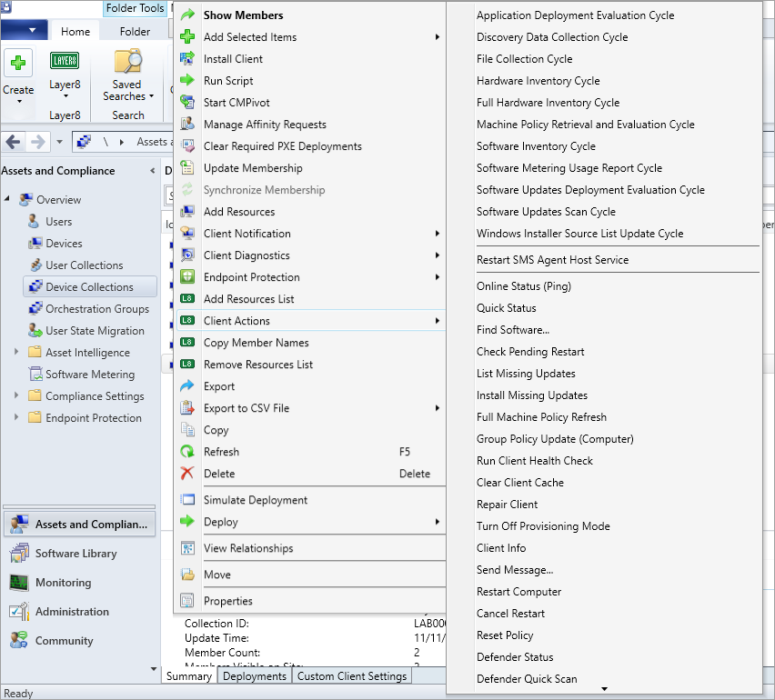

Right-click a device, **Layer8**: the tools for that one device. Its own Client Actions and Remote Tools menus are further down.

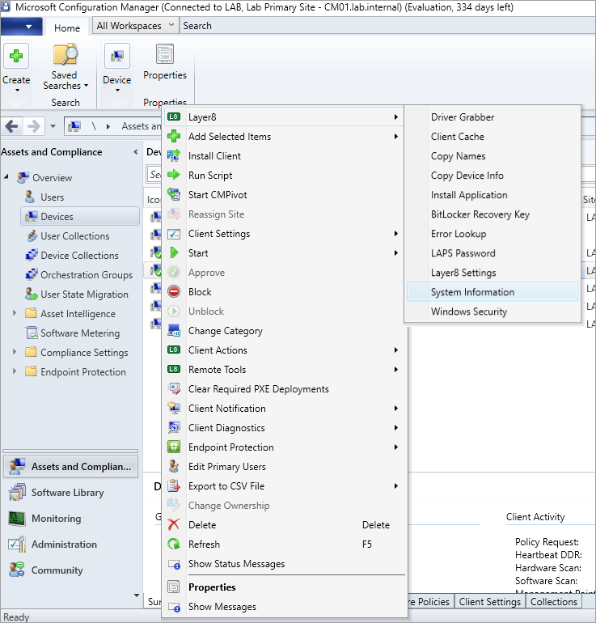

## One row per device

Every client action opens a window like these, with one answer per device: done, offline, blocked, or why it failed. Copy Results pastes into Excel, Export saves a file, and Run Again on Failed retries only the devices that didn't work.

**Quick Status**: who's signed in, uptime, free space on C:, IP address and client version.

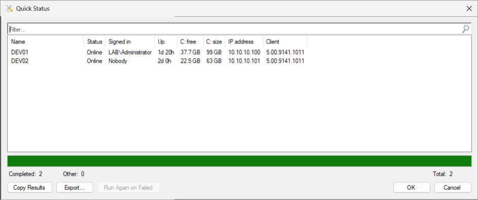

**Check Pending Restart**

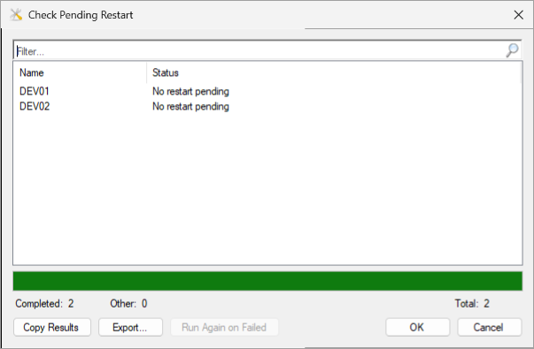

## One device

**System Information**: one window instead of remoting in. It only reads; nothing on the device changes.

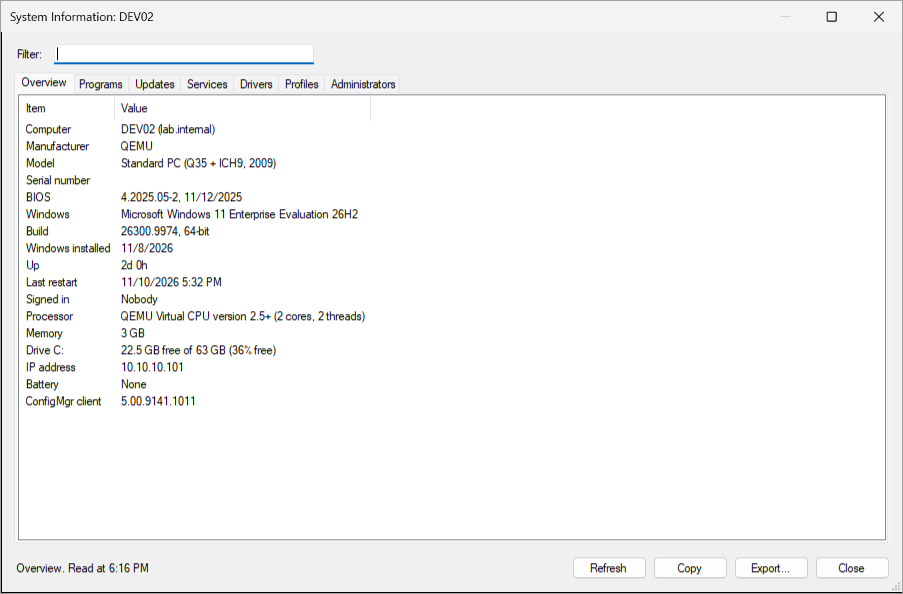

The other tabs (programs, updates, services, drivers, profiles, local administrators) work the same way: sort, filter as you type, copy or export what's shown.

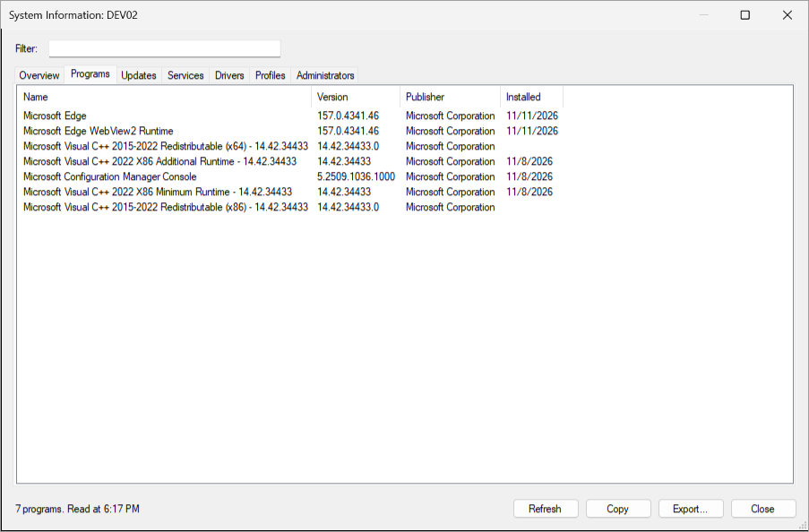

**Windows Security**: Microsoft Defender, Windows Firewall and BitLocker, as the device reports them. Quick Scan starts a Defender quick scan.

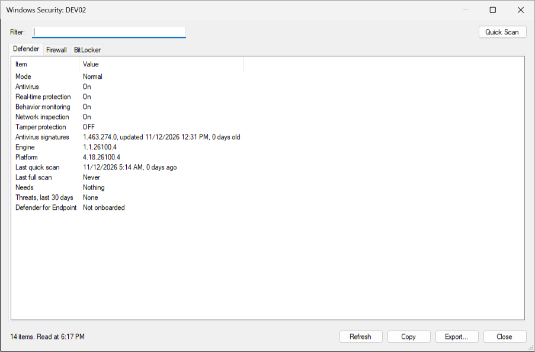

Firewall: each profile as Windows applies it, Group Policy included, and the network it's in use on.

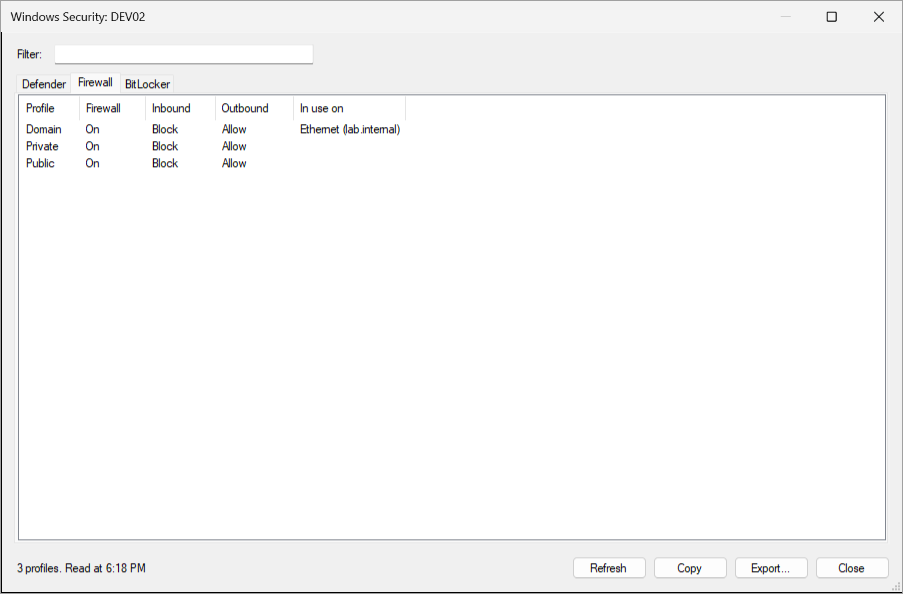

BitLocker: each drive's protection, encryption, method and kinds of key protector, never a recovery password. Suspend pauses protection on the Windows drive for 1 to 15 restarts (for a BIOS update, say), and Resume turns it back on. This lab device isn't encrypted, so there's nothing to suspend.

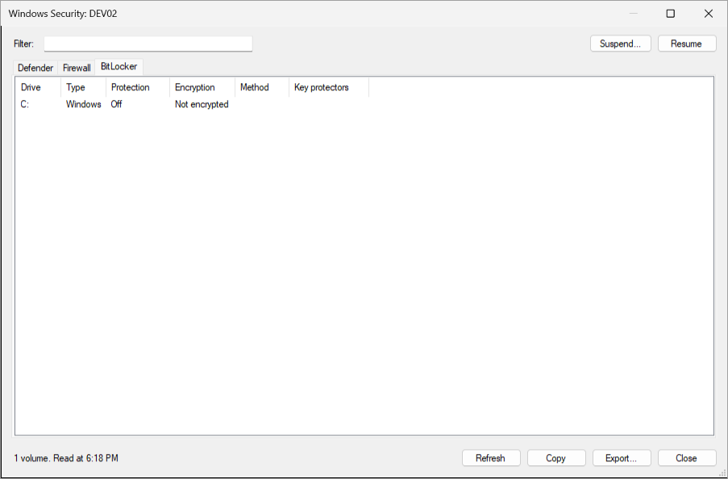

**LAPS Password**: from Active Directory (Windows LAPS, encrypted or not, and legacy LAPS). The password stays hidden until you tick Show. Expire Now has the device change it at its next LAPS check.

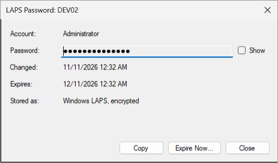

**Install Application**: the apps deployed to the device and where each one stands, with the meaning of any error code. Install starts the selected one now, like Software Center.

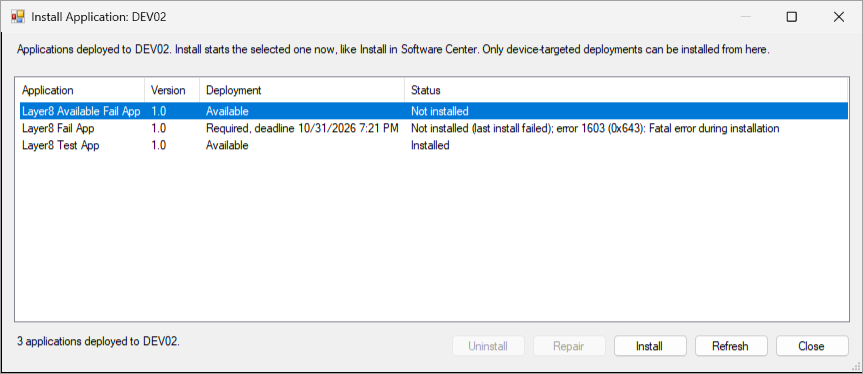

**Error Lookup**: paste a code as hex, decimal or negative and see what it means, from ConfigMgr's error catalog and Windows'.

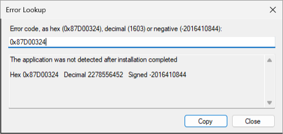

## Deployments

Monitoring > Deployments, right-click a deployment, **Layer8**: Retry Failed Devices re-runs the deployment on every device in error. Copy Failed Devices copies them with their error codes, ready to paste into Excel.

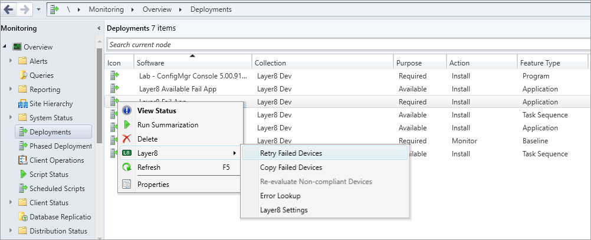

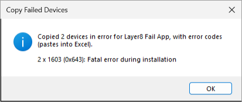

## Collections

**Add Resources List**: paste names, one per line, and Search says which ones ConfigMgr doesn't have. OK adds the rest. Remove Resources List works the same way.

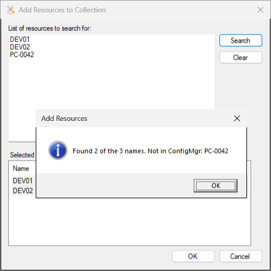

**Collection Evaluation Statistics** (Layer8 on the Device Collections ribbon): the last incremental evaluation, read from colleval.log on the site server, and how long each collection took.

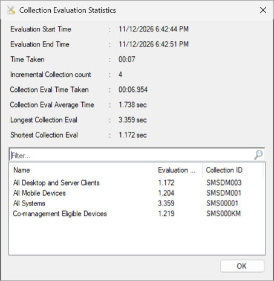

## Driver packages

Software Library > Driver Packages, **Layer8** on the ribbon: the Driver Package Importer and the Dell, HP and Lenovo driver packs.

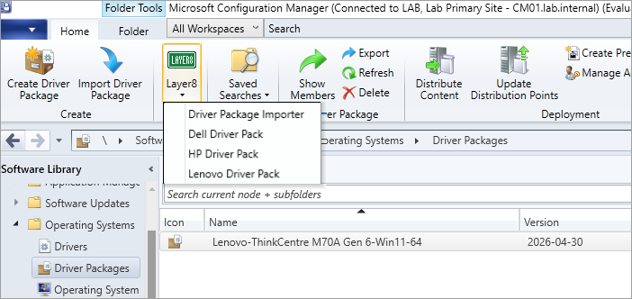

**Lenovo Driver Pack**: Lenovo's packs for the Windows release you pick. The models your site has come ticked, packs you already have say Downloaded, and each download is checked against Lenovo's signed catalog.

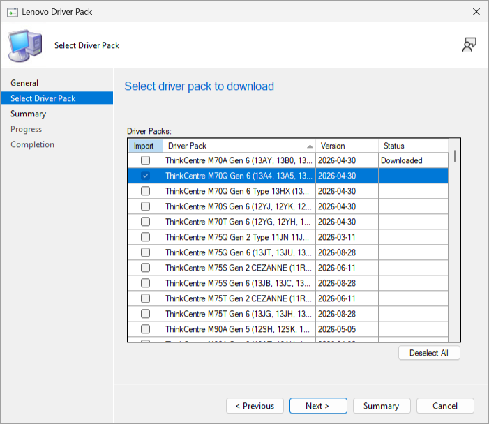

## Settings

**Layer8 Settings** (on the Layer8 menus): how many devices to contact at once, when to ask before a big run, the quick check that each device answers, and the log level. They're saved for your Windows account.

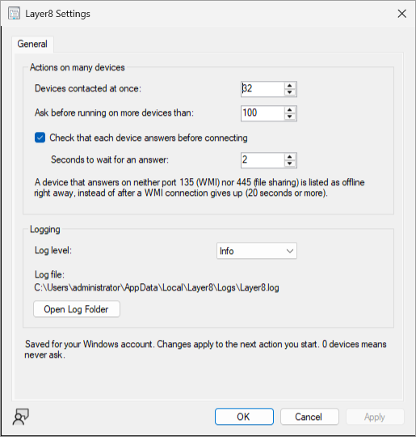
