# Layer8 tour

What Layer8 looks like in the ConfigMgr console. The screenshots are from a lab site (ConfigMgr 2509, later 2609; two Windows 11 clients and the site server). Everything here is on a right-click menu or the ribbon; there's no separate app to open.

## Right-click menus

Right-click a device collection, **Layer8**: **Health Dashboard** first, then **Status** (read-only checks), **Client Cycles**, **Fix** (changes something on the devices) and **Power and Users**, each alphabetical inside. Each action runs on every device in the collection. Below them are Add and Remove Resources List, Collect Client Logs, Copy Member Names and Error Lookup, then Layer8 Settings.

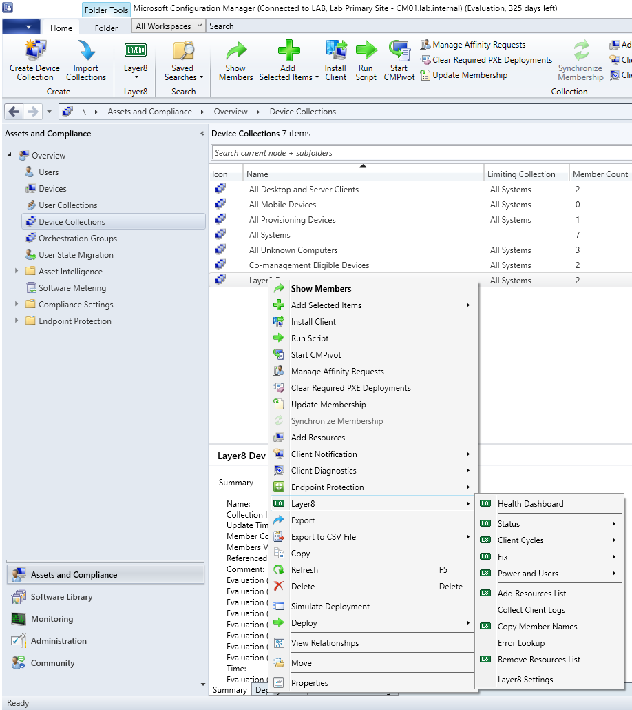

Right-click a device, **Layer8**: **Health Dashboard** first, then everything else in submenus by what each action does. **Status** is read-only checks, **Client Cycles** the eleven standard cycles, **Fix** whatever changes something on the device (repairs, policy, installs, scans), then **Power and Users**, **Security** (read-only: BitLocker key, LAPS password, Windows Security) and **Remote Tools**. Below them are the tools for one device, and Layer8 Settings. Each submenu is alphabetical. Add Selected Items to Existing Device Collections is in the console's own **Add Selected Items** menu.

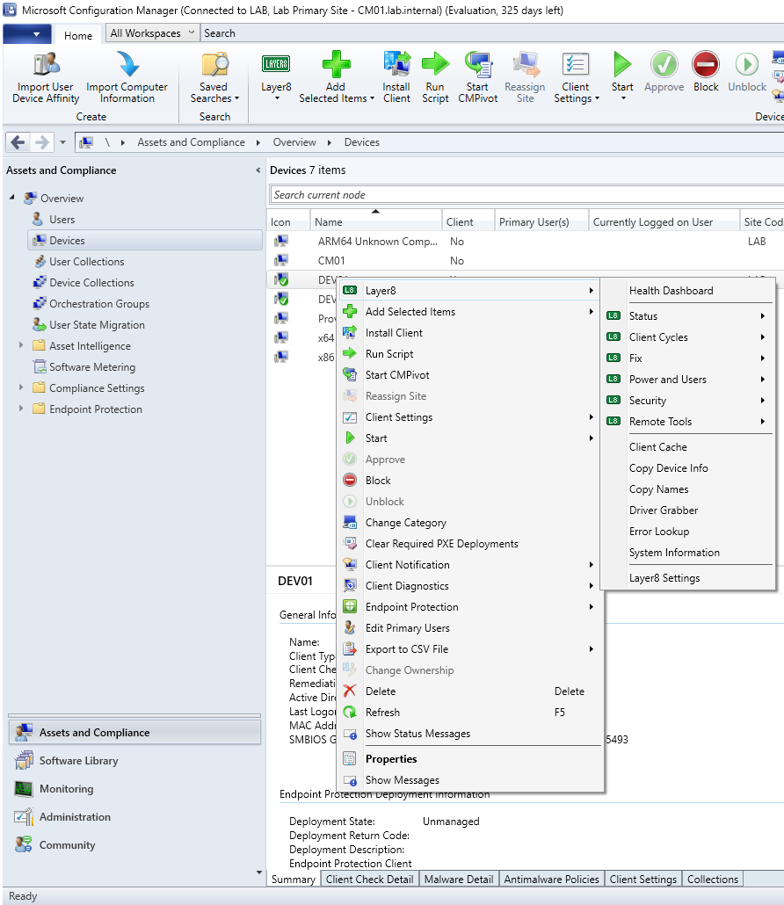

## Health Dashboard

Right-click a device collection, **Health Dashboard** (or select devices, **Layer8** > **Health Dashboard**): one live pass over every device. The tiles fill in as devices answer. Click one to show just those devices; click it again, or **Devices**, for all of them. Hover over a tile for its rule. The grid sorts on any column, filters as you type, and Copy and Export take what's shown. Double-click a device for System Information. Right-click selected devices to check them again, or to run a client action on them: the console's own (policy and inventory cycles, update scans and installs, Send Message, restarts, client health and repair, Defender quick scan, Find Software), with the same questions before anything that changes a device and the same progress window. The check itself only reads.

Each full run on a collection is kept for your Windows account (in `%LOCALAPPDATA%\Layer8\Dashboard`, one small file per collection), so the next run shows what changed: the **Since last run** column says what's new and what's gone on each device, the **Changed** tile counts those devices, and once a run ends each tile shows how its count moved ("+1"), with the last run's count in its hover text. Check Again on a few devices, and a run stopped early, aren't kept. Selected devices, rather than a collection, aren't compared.

| Tile | Counts a device when |
|---|---|
| Offline | it doesn't answer: ports 135 and 445 closed, or WMI's RPC server unreachable. Its row says when ConfigMgr last heard from it ("Offline, last seen 6h ago") and shows what ConfigMgr last had on it in grey; hover it for where each value came from |
| Changed | its issues aren't the ones the collection's last full run found, or it wasn't in that run |
| Restart pending | ConfigMgr, Windows servicing or Windows Update is waiting on a restart |
| Low disk | C: has less than 10 GB free |
| BitLocker off | C: isn't protected: BitLocker off, or protection suspended |
| Defender | antivirus or real-time protection is off, or the signatures are more than 7 days old (not counted when Defender is passive behind another antivirus) |
| Blue screen | Windows wrote a crash dump in the last 14 days (read from the minidump folder; the column shows when, and the stop code) |
| Missing updates | the client reports deployed updates as missing |
| Not scanning | the client's last software update scan finished 14 days ago or more, or it has never finished one (the Update scan column shows how long ago; not counted where client settings turn software updates off) |
| Windows behind | a workstation on a Windows build older than 26100 (24H2) by default; the Windows column shows each device's version and build, servers included, but servers aren't counted |
| Client | there's no ConfigMgr client, its service (CcmExec) isn't running, or it's in provisioning mode |
| Not reporting | the site hasn't had a policy request from its client in 7 days or more (read from the site, so it counts offline devices too) |
| Long uptime | it's been up 14 days or more |
| Couldn't check | it answered but couldn't be checked (access denied, a WMI error), or one check couldn't be read; the Issues column says which |

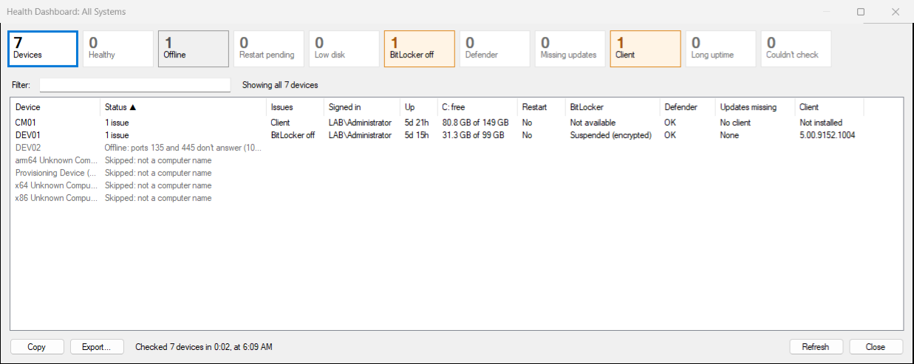

## One row per device

Every client action opens a window like these, with one answer per device: done, offline, blocked, or why it failed. Copy Results pastes into Excel, Export saves a file, and Run Again on Failed retries only the devices that didn't work.

**Quick Status**: who's signed in, uptime, free space on C:, IP address and client version.

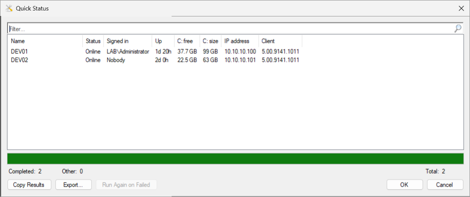

**Check Pending Restart**

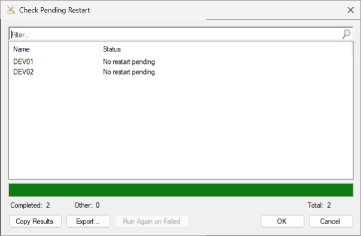

## One device

**System Information**: one window instead of remoting in. Reading changes nothing on the device; the one exception is Uninstall on the Programs tab.

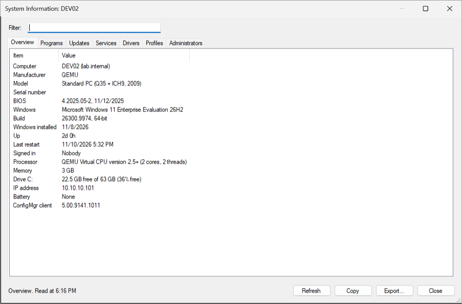

The other tabs (programs, updates, services, drivers, profiles, local administrators) work the same way: sort, filter as you type, copy or export what's shown. On Programs, select a Windows Installer program and click **Uninstall...** to remove it quietly; Layer8 asks first, waits for msiexec, and puts the result in the status line.

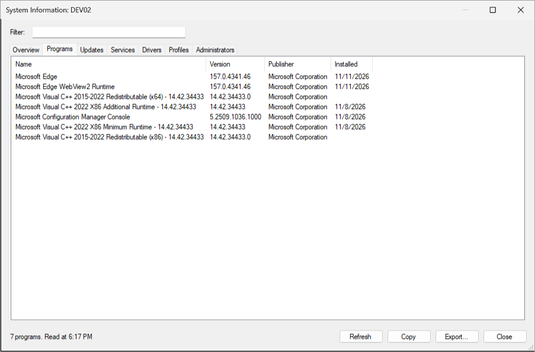

**Windows Security**: Microsoft Defender, Windows Firewall and BitLocker, as the device reports them. Quick Scan starts a Defender quick scan.

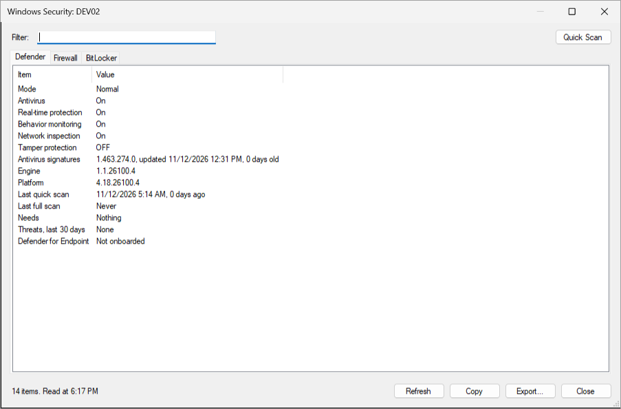

Firewall: each profile as Windows applies it, Group Policy included, and the network it's in use on.

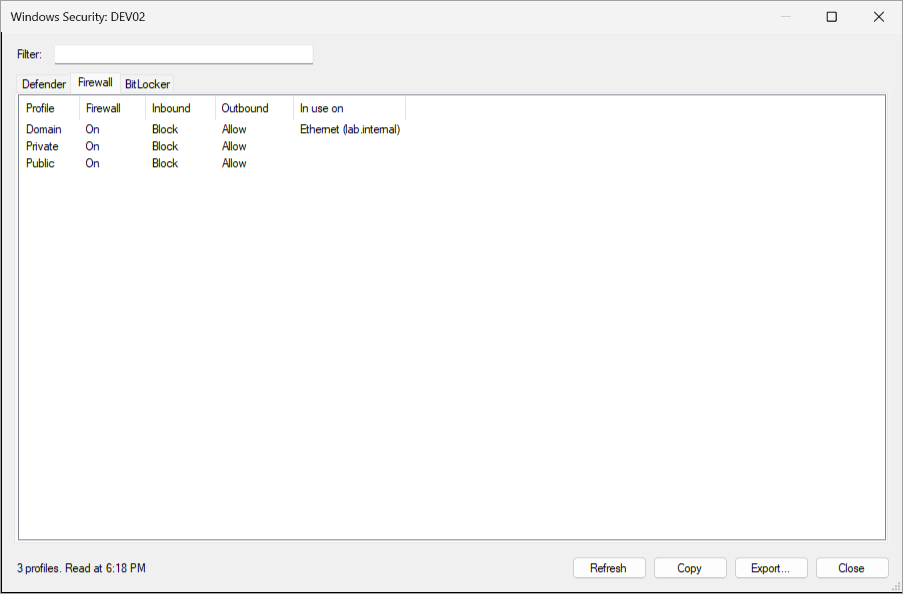

BitLocker: each drive's protection, encryption, method and kinds of key protector, never a recovery password. Suspend pauses protection on the Windows drive for 1 to 15 restarts (for a BIOS update, say), and Resume turns it back on. This lab device isn't encrypted, so there's nothing to suspend.

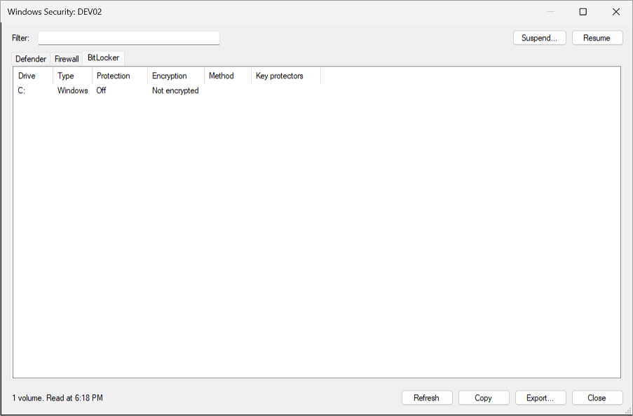

**LAPS Password**: from Active Directory (Windows LAPS, encrypted or not, and legacy LAPS). The password stays hidden until you tick Show. Expire Now has the device change it at its next LAPS check.

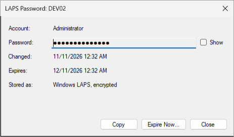

**Install Application**: the apps deployed to the device and where each one stands, with the meaning of any error code. Install starts the selected one now, like Software Center.

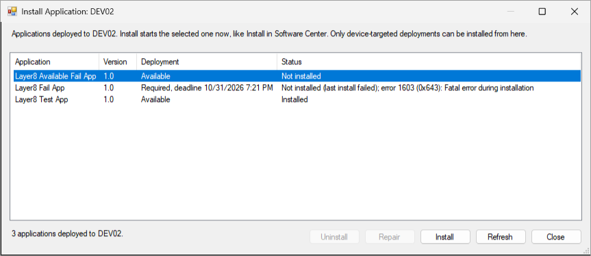

**Error Lookup**: paste a code as hex, decimal or negative and see what it means, from ConfigMgr's error catalog and Windows'.

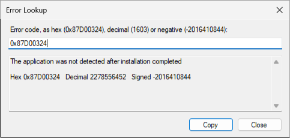

## Deployments

Monitoring > Deployments, right-click a deployment, **Layer8**: Retry Failed Devices re-runs the deployment on every device in error. Copy Failed Devices copies them with their error codes, ready to paste into Excel.

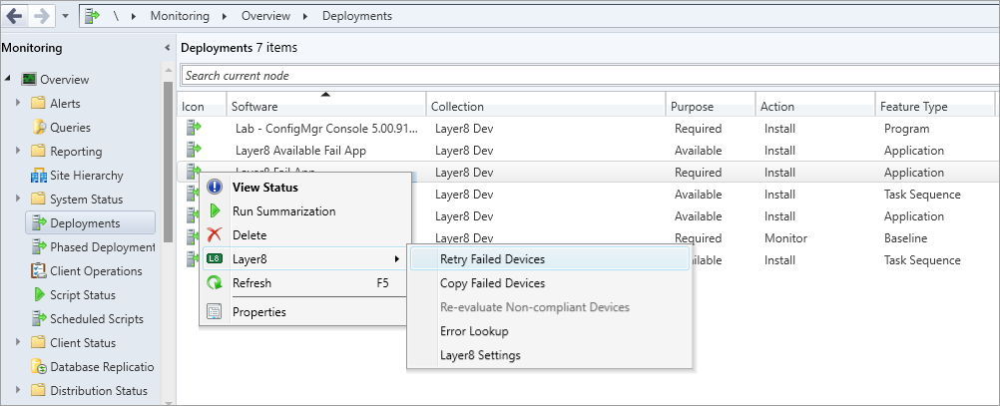

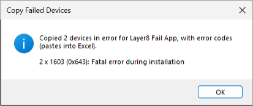

## Collections

**Add Resources List**: paste names, one per line, and Search says which ones ConfigMgr doesn't have. OK adds the rest. Remove Resources List works the same way.

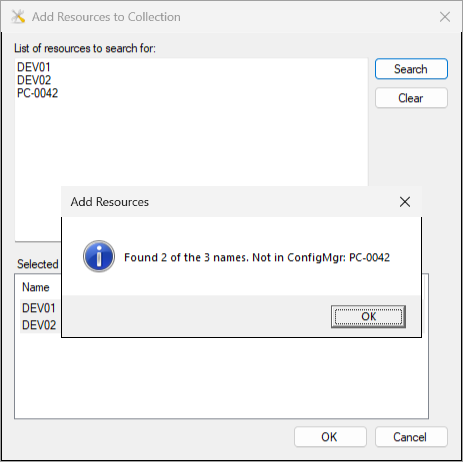

**Collection Evaluation Statistics** (Layer8 on the Device Collections ribbon): the last incremental evaluation, read from colleval.log on the site server, and how long each collection took.

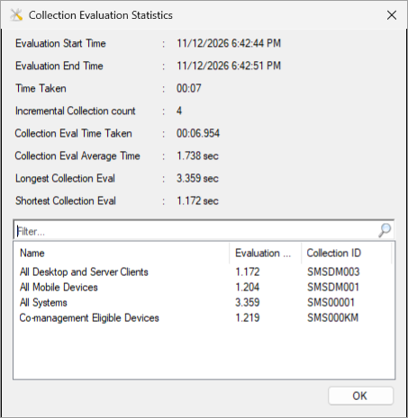

## Driver packages

Software Library > Driver Packages, **Layer8** on the ribbon: the Driver Package Importer and the Dell, HP and Lenovo driver packs.

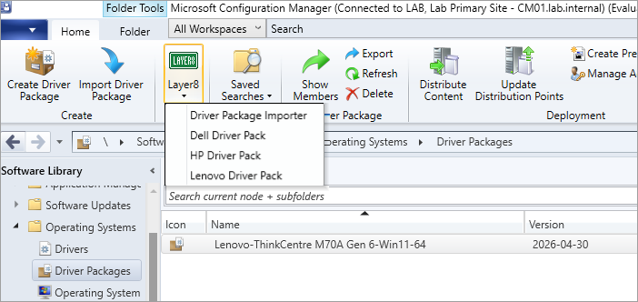

**Lenovo Driver Pack**: Lenovo's packs for the Windows release you pick. The models your site has come ticked, packs you already have say Downloaded, and each download is checked against Lenovo's signed catalog.

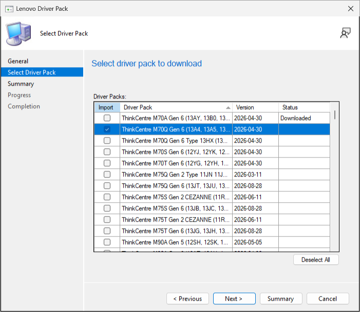

## Settings

**Layer8 Settings** (on the Layer8 menus): how many devices to contact at once, when to ask before a big run, the quick check that each device answers, and the log level. A second page sets the Health Dashboard's low disk, long uptime, not reporting, blue screen, not scanning and Windows behind tiles. They're saved for your Windows account.

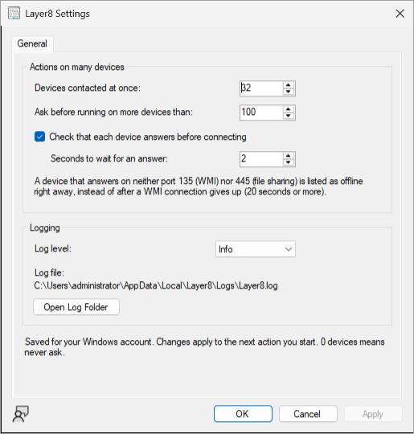
